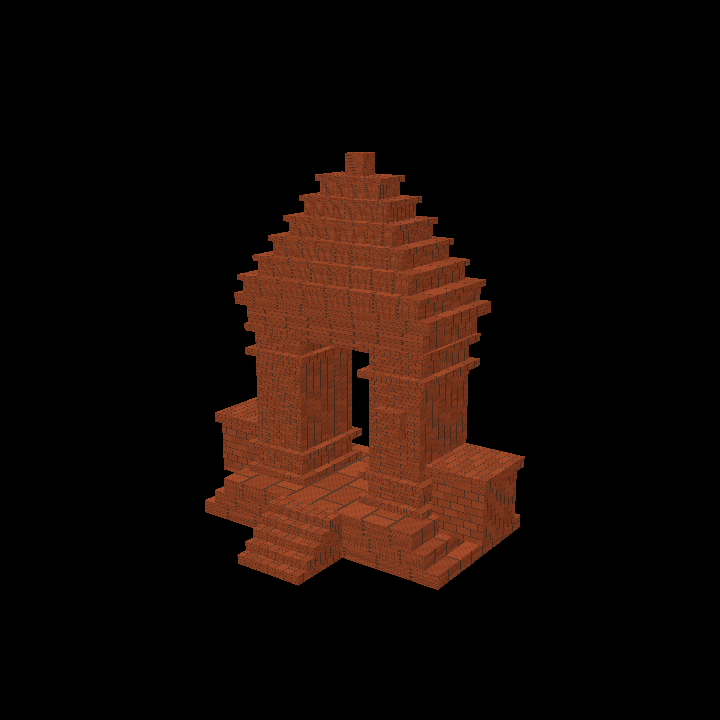
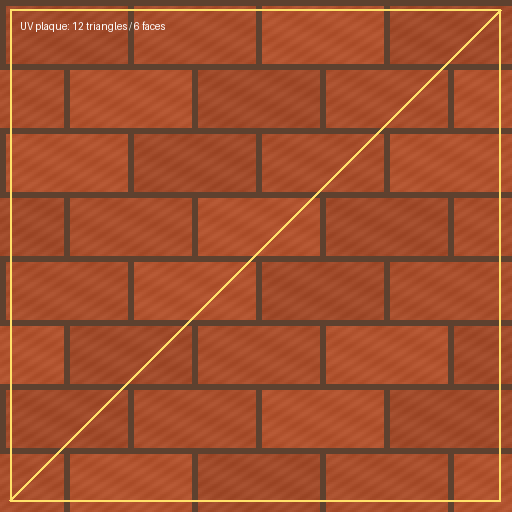
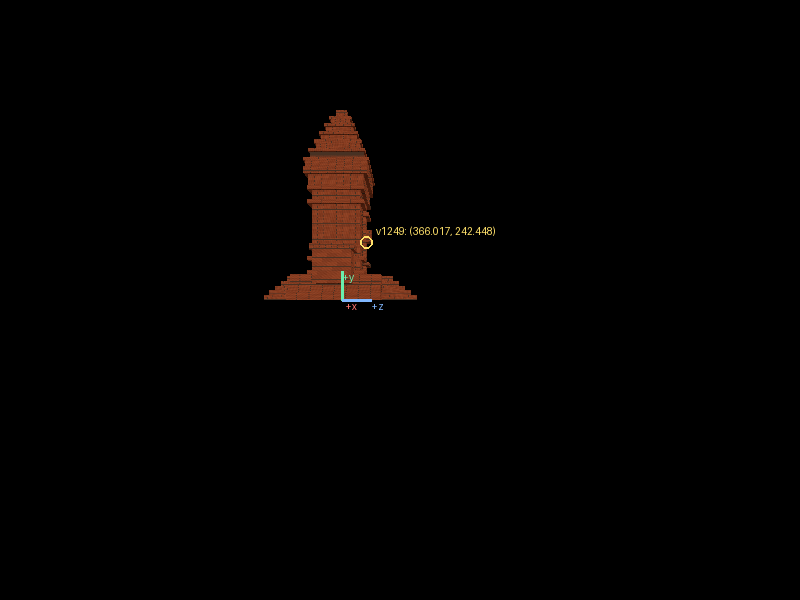

# Lab 1 - Model Bangunan, Telusuran Pipeline, dan Refleksi

Tanggal pencatatan: 2026-11-15T15:06:57+07:00 (Asia/Jakarta).

**Transparansi pengerjaan.** Model, skrip, perhitungan, serta draf analisis ini
disiapkan dengan bantuan Codex atas permintaan pengguna. Bukan klaim bahwa mahasiswa
memodelkan atau menghitungnya manual tanpa bantuan. Turunan skalar di bawah disediakan
untuk diulang dengan tangan dan dipahami sebelum pengumpulan/viva. Model merupakan
blockout interpretatif yang terinspirasi Gapura Bajang Ratu, bukan rekonstruksi terukur.
`Blender/House.blend` hanya diinspeksi; tidak diubah dan tidak dipakai sebagai model final.

## 1. Toolchain yang benar-benar diperiksa

| Komponen | Hasil |
|---|---|
| OS | Windows 11 23H2 (build 22631.6199) |
| Python | 3.11.9 |
| NumPy | 2.4.6 |
| Pillow | 13.0.0 (ekspor/annotasi PNG saja) |
| Node.js / npm | v22.14.0 / 9.9.4 |
| Browser terpasang | Microsoft Edge 157.0.4341.60; Google Chrome 157.0.8103.51 |
| Three.js di import map Module3 | 0.160.0 |
| Pemeriksaan dependensi | No broken requirements found. |

Versi browser dibaca dari executable terpasang. Rendering WebGL dan orbit di browser
belum dijalankan karena itu pekerjaan Lab 3. Bacaan shader untuk butir 5 menggunakan
source Three.js tag r160 (0.160.0), dibaca tanpa dieksekusi. Paket Three.js lama di
folder Modul 2 adalah 0.160.1 dan tidak dianggap sebagai instalasi Module3.

## 2. Input model dan texture

- Model: `data/mymodel.obj`, 636 segitiga, 1272 vertex,
  53 komponen kotak. Ambang 200 segitiga terpenuhi.
- Komponen: alas bertingkat, dua pilar dengan lorong terbuka, ambang atas, enam
  tingkat atap, puncak, sayap, tangga depan/belakang, dan plakat asimetris.
- Texture: `data/lab1_brick.png` dan `.ppm`, 256 x 256, pola bata prosedural asli.
  Material OBJ/MTL menunjuk PNG; renderer NumPy memakai PPM yang pixel-nya sama.
- UV: setiap sisi kotak memiliki empat sudut UV berbeda; 636 dari
  636 segitiga memiliki luas UV positif. Luas UV minimum 0.460800.
- Sumbu object: right-handed, +y ke atas, depan +z. Loader NumPy membalik v sekali
  untuk citra yang baris pertamanya berada di atas.
- Aset baru didedikasikan CC0-1.0; provenance dan batas lisensi ada di
  `data/ASSET_LICENSE.md`. Tidak mengambil texture pihak ketiga.



Gambar di atas dihasilkan rasteriser starter pada kamera (4.8, 3.8, 6.7), target
(0, 1.5, 0), FOV 40 derajat, M identitas. Ini pratinjau bentuk; kamera telusuran
di bagian berikut sengaja berbeda dan parameternya dicatat terpisah.



Semua sisi memakai patch bata yang sama, sehingga UV saling menumpuk secara sengaja.
Ini tiling/reuse texture, bukan atlas unik. Setiap komponen kotak memiliki winding
keluar yang diperiksa dengan signed volume positif. Komponen saling beririsan dan
belum di-union menjadi manifold tunggal; cukup untuk blockout praktikum, bukan mesh
siap cetak 3D. Dimensi satuan arbitrer dan relief arkeologis belum direkonstruksi.
Referensi identitas situs: [Direktori Majapahit, Candi Bajang Ratu][bajang] (2021,
berdasarkan survei 2018). Proporsi model adalah keputusan desain latihan.

## 3. Satu vertex melewati enam space

Vertex OBJ nomor **1249**, indeks Python **1248**, adalah sudut plakat asimetris.
Tidak memakai titik contoh (2,3,4) yang bukan berasal dari model.

Konvensi: column vector, `p' = M @ p`, operasi paling kanan dijalankan dulu;
right-handed; kamera menghadap -z; NDC z [-1,1]; layar y ke bawah.

`M = Ry(90) @ T(1,0,-1)`:

```text
   0.000000    0.000000    1.000000   -1.000000
   0.000000    1.000000    0.000000    0.000000
  -1.000000    0.000000    0.000000   -1.000000
   0.000000    0.000000    0.000000    1.000000
```

`V = look_at((0,0,8), (0,0,0)) = T(0,0,-8)`:

```text
   1.000000   -0.000000    0.000000    0.000000
   0.000000    1.000000    0.000000    0.000000
  -0.000000   -0.000000    1.000000   -8.000000
   0.000000    0.000000    0.000000    1.000000
```

`P = perspective(60, 800/600, 1, 50)`:

```text
   1.299038    0.000000    0.000000    0.000000
   0.000000    1.732051    0.000000    0.000000
   0.000000    0.000000   -1.040816   -2.040816
   0.000000    0.000000   -1.000000    0.000000
```

Turunan skalar sebagai bahan perhitungan tangan, independen dari pemanggilan matriks:

```text
p = (0.480000, 1.050000, 0.380000, 1.000000)
T p = (x+1, y, z-1, 1) = (1.480000, 1.050000, -0.620000, 1.000000)
Ry(90) (T p) = (z-1, y, -(x+1), 1) = (-0.620000, 1.050000, -1.480000, 1.000000)
V (M p) = (z-1, y, -(x+1)-8, 1) = (-0.620000, 1.050000, -9.480000, 1.000000)
```

| Space | Nilai |
|---|---|
| Object (x,y,z,w) | (0.480000, 1.050000, 0.380000, 1.000000) |
| World = M p | (-0.620000, 1.050000, -1.480000, 1.000000) |
| View = V M p | (-0.620000, 1.050000, -9.480000, 1.000000) |
| Clip = P V M p | (-0.805404, 1.818653, 7.826122, 9.480000) |
| NDC = clip.xyz / clip.w | (-0.084958, 0.191841, 0.825540) |
| Screen x,y (kontinu; origin kiri atas) | (366.016725, 242.447679) |
| Depth NDC / depth [0,1] | 0.825540 / 0.912770 |

Lebar/tinggi 800/600. `x_screen=(x_ndc+1)*400`,
`y_screen=(1-y_ndc)*300`. `clip.w=9.480000>0` dan
`abs(clip.xyz)<=clip.w`, jadi vertex berada di frustum sebelum pembagian w.
Turunan skalar world/view cocok dengan matriks hingga lebih dari tiga desimal;
`project()` juga cocok. Transkrip aktual: `vertex_trace.txt`.



Model tampak dari samping karena yaw 90 derajat. Lingkaran menandai proyeksi vertex
yang ditelusuri, termasuk jika titik tersebut tertutup permukaan lain; ini marker
geometris, bukan klaim fragment itu lolos z-test.

## 4. Membaca kolom M dan V

| Matriks | Kolom +x (arah, w=0) | Kolom +y | Kolom +z | Origin (titik, w=1) |
|---|---|---|---|---|
| M | (0.000000, 0.000000, -1.000000, 0.000000) | (0.000000, 1.000000, 0.000000, 0.000000) | (1.000000, 0.000000, 0.000000, 0.000000) | (-1.000000, 0.000000, -1.000000, 1.000000) |
| V | (1.000000, 0.000000, -0.000000, 0.000000) | (-0.000000, 1.000000, -0.000000, 0.000000) | (0.000000, 0.000000, 1.000000, 0.000000) | (0.000000, 0.000000, -8.000000, 1.000000) |

M mengarahkan +x model ke -z world, +y tetap ke atas, dan +z ke +x.
Origin model pindah ke (-1,0,-1), karena vektor translasi juga diputar oleh yaw.
V tidak memutar sumbu; origin world berpindah ke (0,0,-8) pada ruang kamera.
Sebaliknya titik kamera (0,0,8,1) dipetakan V ke (0,0,0,1), sudah diperiksa.
Pada overlay, +y bergerak ke atas layar; +z bergerak ke kanan; +x dominan mengubah
depth karena kini searah -z. Pergeseran kecil x/y layar akibat perspektif konsisten
dengan perubahan jarak, bukan rotasi sumbu yang salah.

## 5. Bacaan shader: satu perbedaan dengan transforms.py

Bacaan yang dipilih adalah [source `project_vertex.glsl.js`, Three.js r160][shader],
salinan lokal bacaan tersimpan sebagai `reading/project_vertex.r160.glsl.js`.
Source ini **dibaca, tidak dijalankan**. Shader membentuk `mvPosition` dari
`transformed` dengan w=1, menerapkan matriks batching/instancing jika fitur itu aktif,
lalu mengalikan `modelViewMatrix` dan `projectionMatrix`. Hasil akhirnya ditulis ke
`gl_Position` sebagai vektor empat komponen di clip space. Di sinilah perbedaan
tanggung jawab yang paling terlihat: fungsi `project()` pada `transforms.py`
segera menghitung `clip.xyz / clip.w` dan mengembalikan NDC ke pemanggil Python,
sedangkan shader tersebut tidak menuliskan pembagian itu sama sekali.

Perbedaan ini diperlukan karena output vertex shader masih harus dapat di-clip
oleh pipeline GPU. Pembagian prematur akan menghilangkan w yang diperlukan untuk
menangani segitiga yang memotong near plane atau pinhole. Hardware kemudian
melakukan perspective divide dan viewport transform. Pada renderer NumPy proyek
ini, alur produksi di `raster3d.render()` tidak menggunakan pembagian prematur dari
helper `project()`; ia mempertahankan clip coordinates, memanggil
`clip_triangle_near()`, lalu membagi koordinat vertex hasil clipping. Artinya
helper `project()` cocok untuk telusuran titik yang sudah berada dalam frustum,
tetapi tidak cukup sebagai pengganti clipping segitiga.

`modelViewMatrix` menggabungkan V dan M, sehingga satu perkalian shader mewakili
dua perubahan ruang yang ditulis terpisah dalam laporan. Instancing menambahkan
pose tiap instance sebelum transformasi model-view tanpa perlu menggandakan
geometri. Namun konvensi matriks, arah kamera, dan nilai near/far tetap harus
dipilih benar oleh aplikasi. Source shader ini tidak memutuskan origin UV atau
lisensi texture; hal tersebut berada di pemuatan aset dan konfigurasi material.

## 6. Refleksi kasus: depth dan port konvensi

Reed menjelaskan distribusi depth sebagai remapping 1/z pada tulisan asli
**3 Juli 2015** [Depth Precision Visualized][reed]. Halaman NVIDIA berjudul
**Visualizing Depth Precision** menampilkan tanggal **21 Oktober 2021** [nvidia];
kedua tanggal ini dibedakan, bukan ditulis seolah halaman NVIDIA bertanggal 2015.
Dengan jarak positif d=-z_view, near=1 dan far=50 milik telusuran ini:

```text
D(d) = far/(far-near) - far*near/((far-near)*d)
     = 50/49 - 50/(49*d),     D(1)=0, D(50)=1
```

| Jarak d | Depth [0,1] | Kode integer 24-bit (pembulatan) |
|---|---|---|
| 1 | 0.000000000 | 0 |
| 2 | 0.510204082 | 8559804 |
| 5 | 0.816326531 | 13695686 |
| 10 | 0.918367347 | 15407646 |
| 25 | 0.979591837 | 16434823 |
| 49 | 0.999583507 | 16770227 |
| 50 | 1.000000000 | 16777215 |

Meter pertama yang terlihat, d=1 sampai 2, menggunakan **51.020408%**
rentang kode, sekitar 8,559,804 dari 16.777.216 kode.
Untuk near=0,01 dan far yang sama, meter pertama d=0,01..1,01 memakai
**99.029707%** rentang; ini menunjukkan biaya near terlalu kecil.
Estimasi lokal jarak antar-kode 24-bit dekat far=50 adalah 0.000146031
satuan, dihitung dari turunan D, bukan pengukuran scene z-fighting Lab 2.

Kemen, **28 November 2012**, membahas pembalikan depth bersama format float
[Maximizing Depth Buffer Range and Precision][outerra]. Reverse-Z memetakan near
ke 1 dan far ke 0, mengubah clear ke 0 dan perbandingan ke GREATER; keuntungan
presisi utamanya muncul dengan floating point dan rentang proyeksi yang sesuai.
Membalik integer 24-bit saja hanya membalik kode. Pada OpenGL desktop, rentang
clip z [0,1] dapat dipilih dengan clip control; jangan mengasumsikan konfigurasi
itu tersedia identik pada WebGL. Karena itu reverse-Z bukan sekadar menukar dua
angka pada viewer ini.

### Empat konvensi yang dipatok

| Aspek | OpenGL/GLSL yang dipakai modul | Direct3D/DirectXMath pembanding |
|---|---|---|
| Handedness | View RH, depan kamera -z | Contoh historis LH, depan +z; modern D3D juga bisa RH |
| Matriks & operasi | Column vector, `P V M p`; upload GL column-major | DirectXMath row-major, row vector, `p M V P`; default packing HLSL column-major |
| NDC z | [-1,1] default; depth storage biasanya [0,1] | [0,1] |
| UV/texel origin | Konvensi image GL kiri bawah; NumPy membalik v sekali | Texel origin kiri atas (D3D10+) |

Handedness, urutan perkalian, dan layout memori adalah keputusan berbeda.
Dokumentasi [DirectXMath][dxmath] menjelaskan pilihan RH/LH dan packing HLSL;
[Microsoft D3D9][d3d9] memberi contoh konversi z dan winding;
[D3D10 coordinates][d3d10] mendefinisikan origin texel. UV pada berkas mesh
tetap sebuah parameterisasi; port perlu menyesuaikan orientasi data citra/sampler,
bukan membalik v secara acak di beberapa tempat.

Scene pengungkap bug: dua quad hampir coplanar jauh untuk hilangnya presisi;
geometri/plakat asimetris dan label F untuk mirror; titik dengan hasil `P V M`
yang sudah diketahui untuk kesalahan transpose/urutan; titik tepat pada near/far
untuk rentang NDC; texture bertanda TOP dan empat warna sudut untuk origin UV.
Pengujian ini sengaja memisahkan kesalahan yang bisa tampak serupa pada kubus simetris.

Perubahan otomatis yang dibuat di `run_lab1.py`: guard menerima M jika determinan
bagian 3x3 positif dan posisi landmark plakat cocok turunan skalar independen.
Kontrol negatif `M @ diag(-1,1,1,1)` wajib ditolak. Pada run ini pose benar diterima
dan mirror ditolak; titik hasil mirror akan mendarat di
(362.187623, 235.962910), sedangkan pose benar di (366.016725, 242.447679).
Ini bukti numerik terhadap mirror sumbu x yang disuntikkan, bukan klaim menangkap
semua kemungkinan bug konvensi; titik near/far dan texture berlabel tetap dibutuhkan.

## 7. Reproduksi dan hasil verifikasi

Jalankan dari direktori Module3 pada PowerShell:

```powershell
python -m venv .venv
.\.venv\Scripts\python.exe -m pip install -r requirements.txt
.\.venv\Scripts\python.exe run_lab1.py
.\.venv\Scripts\python.exe worked_example.py --model data/mymodel.obj --vertex 1248
```

Untuk versi dependensi yang sama persis, ganti file install dengan
`lab1/requirements.lock.txt`. Seluruh generator memakai path relatif terhadap
lokasi skrip, jadi `run_lab1.py` bisa dipanggil dari folder lain.

Hasil: **12 pemeriksaan Lab 1 lulus**. Pratinjau memuat
89,555 pixel terlihat. Matriks/hasil numerik dan setiap
status pemeriksaan disimpan di `results.json`; hash aset di `sha256.json`.
Ini verifikasi teknis Lab 1, bukan klaim Lab 2/3 atau penilaian dosen selesai.
Pemahaman, pengulangan hitung tangan, dan pembelaan lisan tetap dilakukan mahasiswa.

Pengujian regresi starter dijalankan melalui `python make_model.py` lalu
`python tests.py`: delapan pemeriksaan melaporkan OK, tanpa skip pada run itu.
Transkrip tersimpan di `starter_tests.txt`. `ref/temple_ref.ppm` dibuat oleh
rasteriser starter pada run pertama di komputer ini, sehingga pemeriksaan frame
starter merupakan konsistensi terhadap baseline lokal, bukan verifikasi visual
independen. `data/pusaka_model.obj` tetap merupakan fallback 180 segitiga dan
tidak menggantikan `data/mymodel.obj` 636 segitiga milik Lab 1 ini.

## Sumber bacaan

Semua sumber daring diakses 15 November 2026. Link menunjuk sumber yang dibaca;
shader memakai tag versi tetap, sementara dokumentasi API dapat diperbarui.

- [Reed, Depth Precision Visualized, 3 Juli 2015][reed].
- [NVIDIA, Visualizing Depth Precision, 21 Oktober 2021][nvidia].
- [Brano Kemen, Maximizing Depth Buffer Range and Precision, 28 November 2012][outerra].
- [Three.js, project_vertex.glsl.js, tag r160][shader].
- [Microsoft, Getting started with DirectXMath, bagian Matrix convention][dxmath].
- [Microsoft, Coordinate Systems (Direct3D 9), pembaruan 6 Januari 2021][d3d9].
- [Microsoft, Coordinate Systems (Direct3D 10), pembaruan 24 Mei 2021][d3d10].
- [Direktori Majapahit, Candi Bajang Ratu, 2021][bajang].

[reed]: https://www.reedbeta.com/blog/depth-precision-visualized/
[nvidia]: https://developer.nvidia.com/blog/visualizing-depth-precision/
[outerra]: https://outerra.blogspot.com/2012/11/maximizing-depth-buffer-range-and.html
[shader]: https://github.com/mrdoob/three.js/blob/r160/src/renderers/shaders/ShaderChunk/project_vertex.glsl.js
[dxmath]: https://learn.microsoft.com/en-us/windows/win32/dxmath/pg-xnamath-getting-started
[d3d9]: https://learn.microsoft.com/en-us/windows/win32/direct3d9/coordinate-systems
[d3d10]: https://learn.microsoft.com/en-us/windows/win32/direct3d10/d3d10-graphics-programming-guide-resources-coordinates
[bajang]: https://www.direktorimajapahit.id/petabudaya/candi-bajang-ratu
