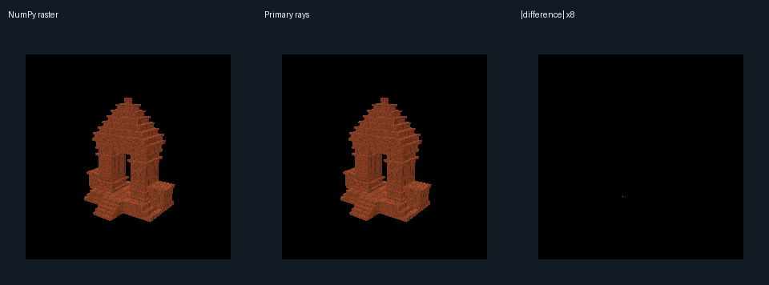
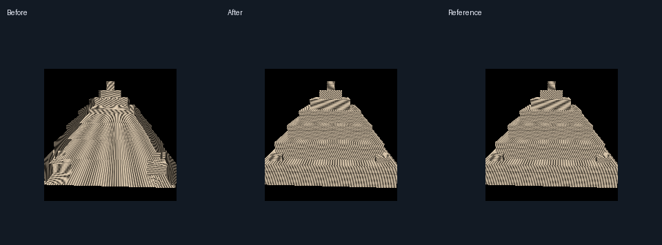
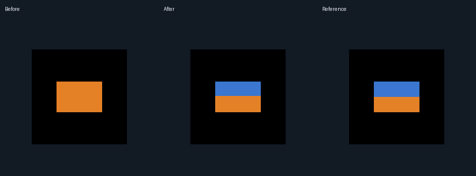
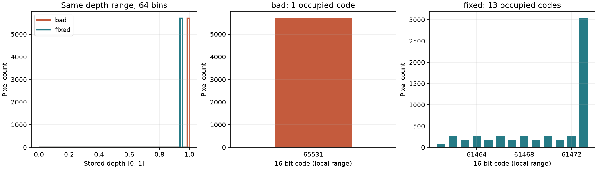
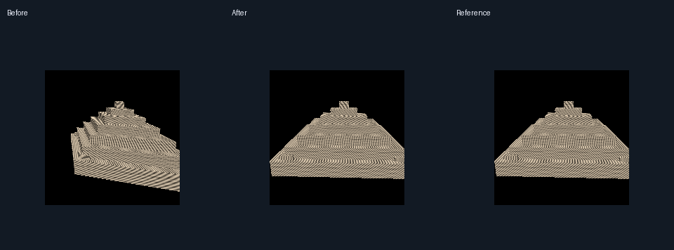
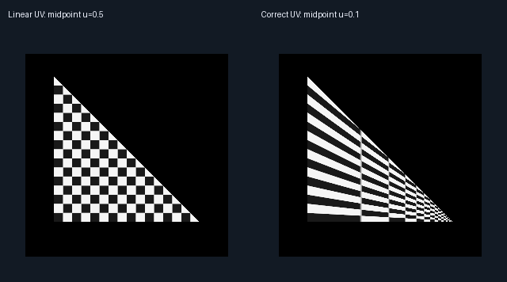
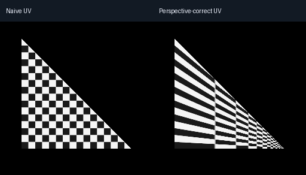
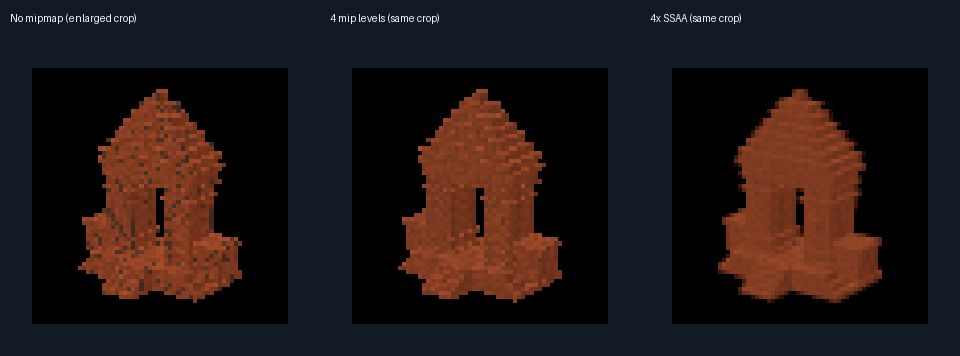
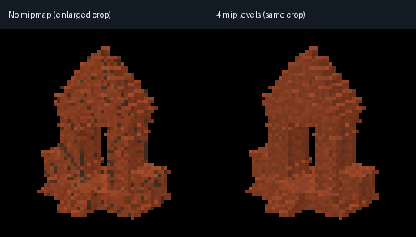

# Lab 2 - Pipeline NumPy, Diagnosis Scene, dan Texture

Pencatatan: 2026-11-15T15:29:39+07:00 (Asia/Jakarta).

**Status:** kelima butir teknis Lab 2 dijalankan. 11
pemeriksaan bukti dan 14 pengujian regresi lulus, tanpa input yang di-skip.
Model utama tetap blockout 636 segitiga dari Lab 1.

**Transparansi:** pekerjaan ini memperluas starter yang disediakan, dengan bantuan
Codex pada kode, eksperimen, dan draf laporan. Tidak diklaim seluruh pipeline
ditulis manual oleh mahasiswa. `diagnosis_before_changes.md` dibuat sebelum patch
Lab 2, tetapi solusi/komentar starter sudah dibaca saat audit; bukan diagnosis buta.
Hasil numerik di sini berasal dari run aktual, bukan angka target dalam PDF.

## 1. Pipeline dari koordinat sampai pixel

`transforms.py` mempertahankan konvensi column vector, right-handed, kamera -z,
`clip=P@V@M@p`, NDC z [-1,1], viewport y ke bawah. `raster3d.py` mempertahankan
clip coordinates hingga near clipping Sutherland-Hodgman, membawa UV melewati
intersection, membagi dengan w, lalu memakai edge function/barycentric, depth test,
UV perspective-correct, bilinear sampling, dan Lambert dalam linear light.
Fragment di luar rentang depth far ditolak; clipping penuh enam bidang bukan
bagian ekstensi ini.

`raytrace.py` membangkitkan satu ray pinhole per pusat pixel, mencari hit terdekat
dengan Moller-Trumbore, menghitung UV melalui barycentric di segitiga world,
dan memakai texture serta Lambert yang sama. Perbaikan Lab 2 menolak hit berdasarkan
jarak sepanjang sumbu kamera, `t * dot(ray_dir, camera_forward)`, agar near/far
cocok dengan rasteriser. Parameter ray t sendiri bukan jarak eye-space untuk ray
yang miring. Kedua renderer berbagi sampler dan fungsi colour space; cross-check
ini independen untuk visibilitas/interpolasi geometri, bukan dua implementasi
texture/shading yang sepenuhnya independen.

| Contoh | Angka yang dicetak pengujian |
|---|---|
| E1 | (2,3,4) -> T: (3,3,3) -> Ry90: (3,3,-3); proyeksi d=2: (2,2); urutan lain: (5,3,-3) |
| E2 | Kamera +x dan model -x sama-sama menghasilkan (4,0,0,1) |
| E3 | eye z=-1 -> NDC -1; eye z=-9 -> +1; eye z=-3 -> 0.5 |
| E4 | u_naif=0.5; u_perspective_correct=0.1 |
| E5 | Depth barycentric=0.625 |

Transkrip lengkap: [tests.txt](tests.txt). Pengujian tambahan membuktikan near-clip
menghasilkan dua triangle dengan UV intersection (1/3,0) dan (0,1/3), serta hasil
clipping near/far cocok dengan hit ray tanpa mengandalkan golden image yang baru dibuat.

### Kecocokan frame

| Perbandingan | Hasil |
|---|---|
| Fallback 160x160 vs referensi dibekukan | inf dB; SSIM global 1.000000; beda 0 pixel |
| Fallback 160x160 raster vs ray | inf dB; SSIM global 1.000000; beda 0 pixel |
| Model Lab 1 256x256 raster vs ray | 64.16574106754942 dB; SSIM global 0.999988; beda 3 pixel |



**Batas bukti:** `ref/temple_ref.ppm` dibuat rasteriser starter saat Lab 1, kemudian
dibekukan dan tidak ditulis ulang. Hash SHA-256: `6ec947c0de042ad847326c626e0fd1e5908394ea27afc2fe9d8ec6732c91bf2e`.
Mencocokkannya adalah regresi lokal, bukan oracle independen. Pengujian sekarang
gagal bila input/referensi hilang; tidak ada lagi auto-generate atau skip yang
tetap mencetak passed. `SSIM` di proyek ini adalah satu window global, bukan SSIM
lokal Gaussian 11x11. PSNR inf berarti byte identik pada konfigurasi itu, bukan
klaim semua kamera/resolusi selalu identik.

Pada model sendiri terdapat 3
pixel berbeda, dengan maksimum selisih channel 68.
Jarak maksimum pusat pixel tersebut ke edge triangle proyeksi terdekat adalah
0.171681013292 pixel. Koordinat, jarak, dan RGB kedua renderer dicatat
di `results.json` (`own_model_residuals`). Ini pemeriksaan lokasi residual;
edge yang dipakai mencakup seluruh triangle, termasuk yang tertutup, sehingga
bukan bukti tunggal tentang triangle mana yang menang pada tie.

Waktu satu run model sendiri: raster 0.3971
detik, ray 5.9580 detik. Angka ini
hanya catatan pelaksanaan, bukan benchmark berulang atau eksperimen prediksi
sebelum ukur yang diwajibkan Lab 3.

## 2. Tiga diagnosis dan bukti perbaikan

| Kasus | SSIM sebelum vs reference | SSIM sesudah vs reference |
|---|---|---|
| inside-out | 0.789685 | 1.000000 |
| zfight | 0.762879 | 0.984151 |
| stretched | 0.706605 | 1.000000 |

### Inside-out: winding dan backface culling

Audit menghitung signed volume kotak pertama fallback **-1.4**, sehingga winding
starter ke dalam meskipun komentarnya menyebut CCW keluar. `outward_fallback()`
mengorientasikan salinan **15 kotak fallback yang sudah diketahui**, bukan melakukan
repair otomatis sembarang OBJ. Berkas model/ref historis tidak ditulis ulang.
Baseline diagnosis memakai winding keluar; bug membalik face dan indeks UV;
perbaikan membalik keduanya kembali dengan culling tetap aktif. Jika hanya face
dibalik tanpa UV, mapping texture dapat bergeser walaupun siluet sudah benar.



RGB dan citra depth ketiganya tersimpan sebagai PNG/PPM; depth numerik tersimpan
sebagai NPY. Nilai before/after dihitung terhadap konfigurasi referensi yang
dipisahkan. SSIM sesudah 1 pada eksperimen deterministik ini berarti konvensi
yang dimaksud berhasil dipulihkan, bukan evaluasi visual independen oleh dosen.

### Z-fighting: near terlalu kecil dan kuantisasi depth

Scene berisi dua quad berpotongan sekitar jarak 15, far=200 dan integer depth
16-bit. Bug: near=0.001. Perbaikan: **hanya naikkan near menjadi 1**, bit depth
tetap. Kuantisasi memakai `2**16-1` interval (65536 kode). Oracle memakai depth
float, dengan near yang disamakan. Oracle near 0.001 dan near 1 menghasilkan RGB
identik, memastikan perbaikan tidak sekadar membuang geometri lewat clipping.

Pixel salah dengan selisih maksimum channel >60 terhadap oracle:
**2852 -> 184**.
SSIM fixed terhadap oracle tidak dipaksa 1; residu kuantisasi masih dilaporkan.





Histogram pertama memakai range [0,1] dan 64 bin yang sama. Panel kedua dan ketiga
memakai kode integer yang benar-benar terisi pada range lokal masing-masing.
CSV histogram dan pasangan kode/frekuensi
disimpan terpisah agar konsentrasi depth tidak tertutup normalisasi citra.
Ringkasan: near buruk 1 kode
unik, near diperbaiki 13 kode
unik. Ini eksperimen 16-bit yang disengaja agar efek terukur, bukan klaim depth
browser pengguna adalah 16-bit.

### Stretched: pertukaran faktor yang benar-benar berbeda

Starter awal menambahkan skala diag(2.2,0.5,1,1) pada rantai yang faktor awalnya
komutatif (skala seragam dan translasi nol). Itu menjelaskan gambar lama, tetapi
tidak mengisolasi kesalahan urutan. Eksperimen Lab 2 memperjelas bug:

```text
T = translate(0.15,0,-0.1)
R = rot_y(35)
S = scale(1.7,1.1,0.9)
bad   = T @ S @ R
fixed = T @ R @ S
```

Faktor sama persis; perubahan tunggal adalah urutan R dan S. Pada good, skala
terjadi di sumbu lokal sebelum yaw; pada bad, hasil yaw di-scale menurut sumbu
world. Kedua matriks lengkap dicatat di `results.json`, sehingga klaim dapat
diperiksa dari angka, bukan hanya thumbnail. Ini berkaitan dengan pitfall urutan
perkalian, sedangkan inside-out dan zfight berkaitan dengan winding serta near.



## 3. UV perspective-correct dan texture yang berenang

Segitiga uji mempunyai wL=1 dan wR=9. Di tengah edge pada layar:

```text
u_naif = 0.5
u/w    = 0.5*(0/1) + 0.5*(1/9) = 1/18
1/w    = 0.5*(1/1) + 0.5*(1/9) = 5/9
u      = (1/18)/(5/9) = 0.1
```

Renderer memiliki opsi `perspective_correct=False` sebagai kontrol negatif.
Triangle dan UV tetap sama; hanya interpolasinya yang diubah. Terhadap ray caster,
UV naif: 10.904529999275393 dB; SSIM global 0.597481; beda 9360 pixel; UV benar: 84.53469032435927 dB; SSIM global 1.000000; beda 15 pixel.





GIF memakai pergeseran kamera/target sejajar dari -0.12 sampai +0.12 unit. Pola
naif terdistorsi terhadap permukaan 3D; kontrol perspective-correct cocok dengan
ray caster. Distorsi tidak hanya ditunjukkan lewat u=0.1 yang dicetak.

## 4. Mipmap empat tingkat, linear light, dan minification

`texture_sampling.build_mipmaps()` mendecode sRGB sekali, melakukan box-average
2x2 di linear light, kemudian mengulangi ke ukuran **256,128,64,32**. Uji checker
hitam/putih menghasilkan mean linear 0.5, yang di-encode ke sRGB **188**, bukan
rata-rata byte 128. Pillow hanya menulis PNG; seluruh filter memakai NumPy.

LOD memakai turunan analitik hasil interpolasi rasional q/r:
`dUV/dx=(dq/dx - UV*dr/dx)/r`, dan serupa untuk y. Footprint adalah maksimum
panjang gradien dalam satuan texel; LOD=log2(footprint). Trilinear membaurkan dua
tingkat terdekat dan membatasi LOD ke rentang empat level yang ada.

Scene jauh memakai model sendiri dan texture bata yang sama, kamera (12,8,17),
target (0,1.5,0), FOV45, near1/far80, resolusi 256x256. Pembandingan tambahan
merender 1024x1024 kemudian box-downscale 4x di linear light. SSAA 4x adalah
pendekatan integrasi pixel, bukan oracle eksak untuk semua frekuensi texture.



Montase memperbesar crop yang sama dengan nearest-neighbor agar texture terbaca;
frame asli tetap 256x256 dan itulah yang dipakai untuk semua metrik.



| Ukuran bukti | Tanpa mipmap | Mipmap 4 level |
|---|---|---|
| Energi Laplacian luminansi linear | 0.008216306 | 0.004509796 |
| MAE channel ke SSAA4 (byte sRGB) | 6.870577 | 4.350714 |
| MAE frame berurutan, gerak subpixel | 6.671507 | 2.699241 |

Energi frekuensi tinggi turun **45.11%** pada mask
interior 1074 pixel (silhouette dierosi satu pixel). MAE temporal
mencakup gerak nyata serta variasi sampling, bukan pengukuran aliasing murni dengan
motion compensation. Rata-rata LOD 3.000, maksimum 3.000.
Empat level mencapai batas LOD 3 di run jauh ini; artefak pada geometri,
tepi atau minification lebih ekstrem dapat tetap ada. Hasil membuktikan penurunan
aliasing yang terukur, tidak mengklaim semua kelap-kelip hilang pada semua jarak.

## 5. Perbaikan pitfall: backface culling yang diukur

Model Lab 1 sudah mempunyai winding keluar, sehingga culling dapat dibandingkan
tanpa menyembunyikan masalah winding starter. Kamera dan material sama seperti
frame sendiri pada bagian 1. `covered_fragments` menghitung candidate pixel
di dalam triangle **sebelum z-test**, sedangkan `depth_passes` adalah update warna
yang benar-benar lolos. Kedua ukuran dicatat agar definisi penghematan jelas.

| Ukuran | Culling off | Culling on |
|---|---|---|
| Candidate fragments | 59640 | 29820 |
| Depth passes / penulisan warna | 33822 | 26558 |
| Triangle yang di-cull | 0 | 318 |

Candidate fragments turun **50.00%**,
sementara RGB identik (inf dB; SSIM global 1.000000; beda 0 pixel). Ini pengurangan pekerjaan
fragment pada mesh/kamera yang diuji, bukan jaminan percepatan waktu 50%.

## 6. Reproduksi, provenance, dan batas pekerjaan

Dari folder Module3 di PowerShell:

```powershell
.\.venv\Scripts\python.exe -m pip install -r requirements.txt
.\.venv\Scripts\python.exe -m pip install -r lab2/requirements-report.txt
.\.venv\Scripts\python.exe tests.py
.\.venv\Scripts\python.exe run_lab2.py
.\.venv\Scripts\python.exe broken_scene.py --all
```

Untuk environment terkunci penuh: `pip install -r lab2/requirements.lock.txt`.
Matplotlib hanya dipakai untuk plot laporan dan tidak diimpor oleh renderer.
`run_lab2.py` membutuhkan input model Lab 1 dan fallback yang sudah di-commit;
jika perlu membuatnya ulang, jalankan `make_lab1_model.py` dan `make_model.py`.
`results.json` berisi parameter dan metrik; semua NPY/histogram/PPM disimpan di
`lab2/`, bukan hanya thumbnail. `starter_bugs_before_changes.txt` mempertahankan
hasil starter awal, termasuk angka/labelling yang dikoreksi melalui audit.

Pengujian E1-E5, clipping terhadap ray, box filter gamma, trilinear, UV against ray,
dan kesamaan RGB culling melaporkan **14/14 passed**. Model dan texture dari Lab 1
tetap memakai provenance yang sama. Kode starter tetap dikreditkan, dan mahasiswa
perlu mengulang hitungan tangan serta memahami diagnosis sebelum viva.

Lab 2 ini tidak mencakup publikasi GitHub Pages atau verifikasi browser; itu Lab 3.
Ray caster belum memiliki reflection, shadow sekunder, BVH atau global illumination.
Normals diturunkan dari geometri world untuk flat shading; tidak ada klaim sistem
smooth-normal inverse-transpose. Clipping sisi frustum penuh dan anisotropic filtering
juga belum ditambahkan. Itulah batas konkret konfigurasi yang diukur.
