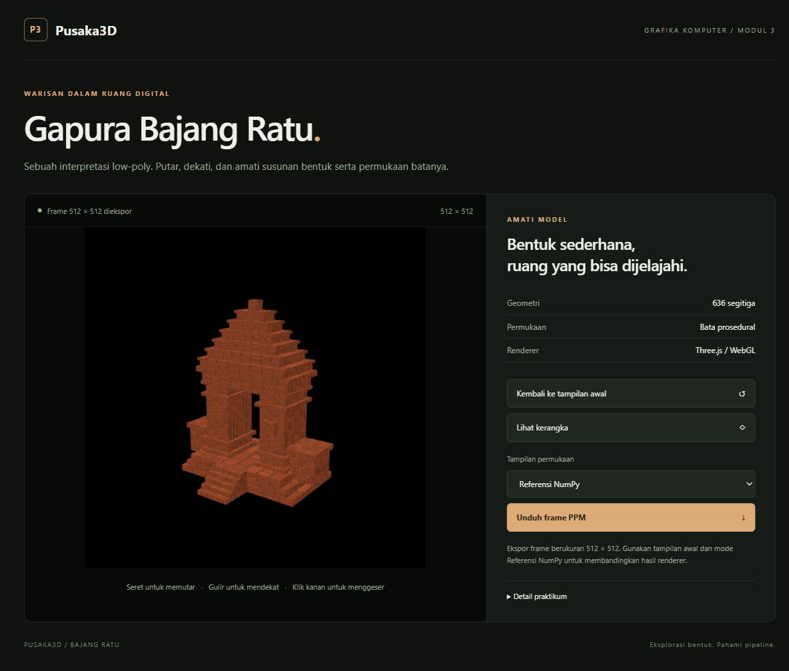
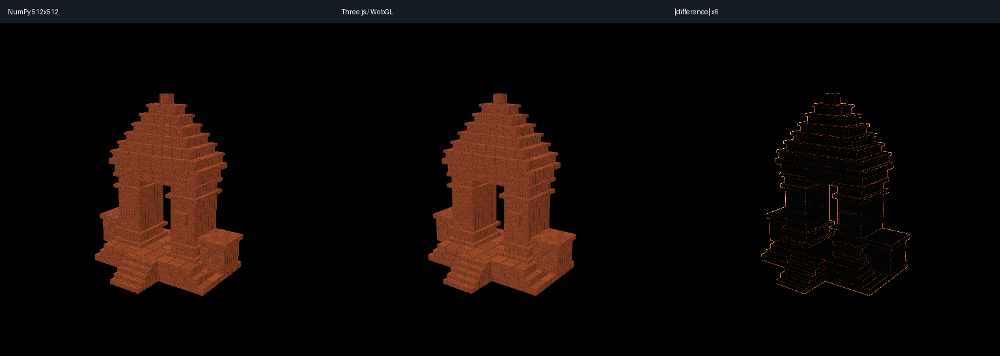
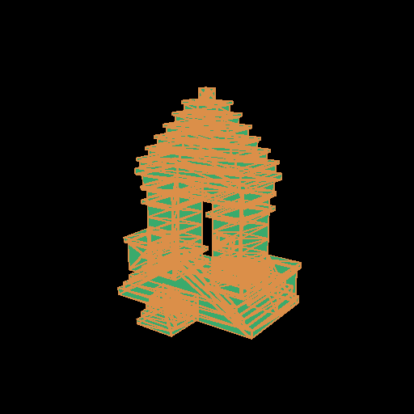
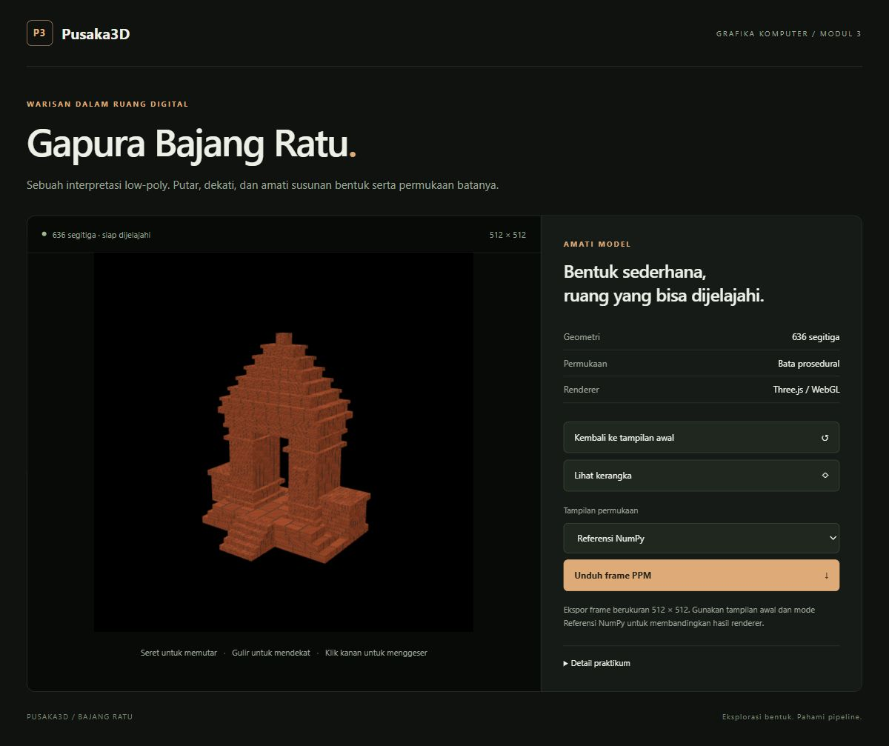

# Lab 3 - Viewer WebGL, Perbandingan Renderer, dan Publikasi

Model: blockout terinspirasi Gapura Bajang Ratu, **636 triangle**. Pengerjaan
dengan bantuan Codex, melanjutkan starter dan hasil Lab 1/2. Bukan klaim seluruh
kode/model/hitungan dikerjakan manual tanpa bantuan. Tanggal: 15 November 2026.

## 1. Viewer yang dijalankan di browser

`web/` kini mandiri: model OBJ, PNG, material/lisensi, Three.js **0.160.0**, OBJLoader
dan OrbitControls berada di dalam folder itu. Tidak perlu CDN saat runtime;
versi dan SHA-256 modul dicatat di `web/vendor/manifest.json`. Model M identitas,
kamera (4.8,3.8,6.7), target (0,1.5,0), FOV40, near1/far50. Drawing buffer
512x512 dan `setPixelRatio(1)` sudah diperiksa melalui metadata browser.

Pengujian UI: drag mengubah posisi kamera ke
[-4.6912739404435815, 3.799999999999999, 6.77657353060637]; tombol
reset mengembalikannya ke posisi awal. Toggle wireframe, pilihan mipmap, unduhan
PPM, dan unduhan JSON bekerja. Console tidak mencatat error/warning pada pengujian
lokal. Ukuran mobile awal serta breakpoint desktop diperiksa; viewport sementara
dikembalikan ke ukuran semula setelah pengujian. Ekspor tetap 512x512 walaupun
canvas diskalakan oleh CSS.



Bukti lain: `viewer_orbit.jpg`, `viewer_wireframe.jpg`, `viewer_mipmap.jpg`,
`browser_reference.json`, `browser_orbit.json`, `browser_after_reset.json`.
User agent aktual: `Mozilla/5.0 (Windows NT 10.0; Win64; x64) AppleWebKit/537.36 (KHTML, like Gecko) Chrome/157.0.0.0 Safari/537.36`. WebGL: `WebGL 2.0 (OpenGL ES 3.0 Chromium)`.

## 2. Mencocokkan NumPy dan WebGL

Frame WebGL berasal dari tombol **Unduh frame PPM**, menggunakan `gl.readPixels`
dan pembalikan baris agar origin file berada di kiri atas. Tidak dibuat ulang
atau disimulasikan menggunakan Python. Frame browser disimpan sebagai
`lab3/mymodel_three.ppm`; alias lokal `web/mymodel_three.ppm` sengaja di-ignore Git.

Ada dua konvensi penting untuk kecocokan bagian dalam:

1. Lambert r160 membagi irradiance dengan pi. Intensitas ambient dan directional
   dikalikan pi agar persamaan akhirnya sama dengan NumPy `0.15+0.85*max(N.L,0)`.
2. Sampler starter memakai `u*(W-1)`. Offset setengah texel dan repeat `(W-1)/W`
   menyamakan pusat texel GPU pada UV model yang berada di 0.02..0.98. Ini bukan
   perubahan universal untuk setiap UV yang melintasi seam repeat.

Texture diberi sRGB, perhitungan lighting linear, keluaran sRGB, tone mapping mati.
Mode referensi mematikan mipmap agar sama dengan NumPy bilinear; mode halus
mengaktifkan mipmap GPU. Kamera dan M/V/P dibandingkan secara numerik dengan
array column-major Three.js; maksimum selisih matriks 2.609e-15.

| Region | PSNR (dB) | SSIM global | MAE channel [0..255] |
|---|---|---|---|
| Seluruh frame | 41.469985 | 0.997802873 | 0.254723 |
| Interior permukaan | 48.062617 | 0.999744583 | 0.520585 |
| Sekitar edge | 32.803707 | 0.990245753 | 1.735945 |





Interior memakai 10469 pixel yang tidak berada pada garis edge
triangle berketebalan tiga pixel; seluruh edge proyeksi dikecualikan termasuk
triangle tertutup, sehingga mask ini konservatif. Region edge berisi
35326 pixel. Silhouette IoU 0.990042581.
SSIM yang dipakai adalah satu window global, bukan local-window SSIM Gaussian.

Residual terbesar di tepi berkaitan dengan MSAA browser yang tidak dipakai raster
CPU. Interior juga menyisakan perbedaan; rounding/precision, interpolasi texture
GPU, dan pemilihan face pada geometri bertumpuk belum diisolasi satu per satu.
Penyebab khusus setiap outlier interior belum dibuktikan, sehingga tidak diklaim
semua residual hanya MSAA di tepi. Material hanya Lambert, tanpa
specular; tidak ada highlight specular yang dipakai sebagai alasan selisih.

## 3. Prediksi, pengukuran, dan keputusan

[Prediksi sebelum pengukuran](predictions_before_measurement.md) dicatat sebelum
benchmark 512x512. Informasi run Lab 2 256x256 sudah diketahui: raster0.397s dan
ray5.958s. Prediksi baru: raster0.6-1.5s, ray20-35s, rasio20-35x (tengah25x).

Satu warmup 64x64 per renderer lalu tiga run CPU pada scene/resolusi sama:

| Renderer | Sampel waktu (detik) | Median (detik) |
|---|---|---|
| raster | 0.635044 / 0.549195 / 0.545362 | 0.549195 |
| ray | 24.873449 / 28.311161 / 37.195981 | 28.311161 |

Rasio median aktual **51.550x**. Median ray berada dalam
rentang prediksi; raster sedikit lebih cepat daripada batas bawah prediksi,
sehingga prediksi rasio terlalu rendah. Pembagian frame ke beberapa triangle kecil
membatasi banyak bounding box raster, sedangkan ray caster brute-force menguji
setiap ray terhadap seluruh triangle. Run dilakukan di komputer yang juga
menjalankan browser; beban mesin tidak diisolasi, dan penyebab variasi antarsampel
tidak diukur. Seluruh sampel dipertahankan, bukan hanya run tercepat.

CPU raster/ray 512x512 mencapai PSNR **68.278708 dB**, SSIM global
0.999995438, berbeda di 12 pixel. Itu pembandingan
primary visibility dan Lambert. **Secondary hard shadow dan reflection belum
diimplementasikan** pada kedua renderer CPU; tidak diklaim ada peningkatan
kualitas efek tersebut dari gambar primary yang hampir sama. Pembahasan
shadow/reflection di prediksi bersifat konseptual.

Pilihan viewer: **Three.js/WebGL GPU**, karena targetnya interaksi orbit dengan
draw call GPU. Metadata browser mencatat median interval rAF
16.700 ms dan CPU render submission
0.100 ms dari 240 sampel terakhir.
Submission CPU bukan waktu GPU selesai, dan rAF bukan jaminan frame rate pada
setiap perangkat. Angka ini tidak disamakan dengan benchmark CPU di tabel.

Pilihan beauty shot yang membutuhkan pantulan/GI: **renderer ray/path tracing
yang mendukung secondary transport**, bukan menganggap ray caster primer ini
sudah merupakan renderer marketing lengkap. Jika hanya membutuhkan Lambert
tanpa efek tersebut, raster yang hasilnya hampir identik lebih hemat waktu.
Pilihan dapat berbalik pada GPU dengan RT acceleration dan kebutuhan reflection
dinamis; atau pada target frame rate ketat/perangkat lemah yang lebih cocok dengan
raster dan pencahayaan baked. Itu batas konkret keputusan, bukan klaim satu metode
selalu unggul.

## 4. Publikasi dan reproduksi

Repositori tujuan pengguna: [riooptr/grafkom-modul3](https://github.com/riooptr/grafkom-modul3).
URL viewer: [https://riooptr.github.io/grafkom-modul3/](https://riooptr.github.io/grafkom-modul3/). Status tercatat: **built**.
Isi `web/` dipublikasikan dari branch `gh-pages` root. Source lengkap, laporan,
model, texture, dan pengujian tetap berada pada branch utama. Token GitHub hanya
dibaca dari Git Credential Manager ke memori proses, tidak ditulis ke repo.

Deployment GitHub Pages: commit `e1cdedc734f9dc665ad7fc1b53a1ec299ef4932a`,
HTTP `200`. Viewer publik, orbit/reset, dan ekspor
PPM diuji dari URL publik, dengan console tanpa error/warning. Frame publik
identik dengan ekspor lokal: `True`.
Checksum viewer.js, CSS, OBJ, PNG dan modul Three.js yang ter-host cocok dengan
source yang disiapkan. Bukti metadata publik tersimpan sebagai
`browser_public_reference.json`, `browser_public_orbit.json`, dan
`browser_public_console.json`.



```powershell
git clone https://github.com/riooptr/grafkom-modul3.git
cd grafkom-modul3
python -m venv .venv
.\.venv\Scripts\python.exe -m pip install -r requirements.txt
.\.venv\Scripts\python.exe make_model.py
.\.venv\Scripts\python.exe tests.py
npx --yes serve@14.2.4 web
```

Tidak perlu build/npm install untuk viewer karena modul dan aset sudah tersimpan
lokal. `prepare_web.py` menyinkronkan aset dari data dan memverifikasi manifest;
unduhan vendor hanya diperlukan bila file belum ada atau diminta refresh.
Benchmark dapat diulang dengan `benchmark_lab3.py`; analisis frame aktual dengan
`analyse_lab3.py`. Script analisis tidak mengendalikan browser dan tidak membuat
frame WebGL palsu. Lihat `clean_clone_verification.txt` untuk transkrip clone
bersih dan `deployment.json` untuk status deployment yang benar-benar diperoleh.

Clone bersih yang diperiksa berasal dari commit `97a7f954a3ceff2fca0433d0c8e09244eaa6e131`,
menggunakan virtual environment baru; status pengujian
`14/14 passed; none skipped`. Status serve/browser:
`verified: npx serve@14.2.4 web, 636 triangles, no console errors`. Clone verifikasi mendahului commit
dokumentasi akhir; hasil berikutnya hanya menambahkan bukti dan laporan, tidak
mengubah source viewer atau pipeline yang sudah diuji.

## 5. Refleksi pipeline (bahan dipahami sebelum viva)

Three.js mengambil alih pengiriman vertex/index buffer, penggabungan matriks
model-view, penyiapan shader, dan draw call. GPU melakukan clipping, pembagian w,
viewport, pembentukan fragment, interpolasi perspective-correct, depth test,
texture sampling, dan multisample resolve. Tugas yang sebelumnya menjadi loop
NumPy kini berjalan melalui pipeline GPU. OrbitControls membangun perubahan pose
kamera dari drag pengguna, tetapi tidak dapat memperbaiki konvensi aset yang salah.

Konvensi tetap menjadi tanggung jawab aplikasi: winding harus sesuai culling,
near/far harus menjaga visibilitas dan presisi depth, UV harus cocok dengan origin
pixel texture, dan texture sRGB harus didecode sebelum perhitungan cahaya linear.
Eksperimen ini juga menunjukkan bahwa persamaan Lambert serta pusat texel perlu
disamakan. Model dan kamera benar belum menjamin frame pixel-wise cocok jika
pengaturan sampling atau intensitas lampu berbeda. Mipmap sengaja dipisahkan
dari mode referensi agar perbedaan filter tidak disalahartikan sebagai bug MVP.

Pada 200.000 triangle, ray caster brute-force menjadi hambatan utama karena
jumlah intersection meningkat sebagai triangle dikali pixel; 512x512 berarti
sekitar 52,4 miliar uji triangle per frame sebelum akselerasi. BVH atau struktur
spasial diperlukan. Raster CPU juga perlu memperbaiki overhead loop/bounding box.
Di WebGL, vertex/fragment throughput, overdraw, draw call, dan bandwidth texture
bergantung pada scene; jumlah triangle saja tidak menentukan frame rate. Mesh
perlu diprofilkan, material/batching dikelola, dan LOD dipertimbangkan. Angka
200.000 ini pembahasan skala, bukan hasil benchmark mesh sebesar itu.

Hasil ini menutup pekerjaan teknis Lab 3. Pemahaman, pengulangan perhitungan
tangan, dan pembelaan satu commit tetap perlu dilakukan mahasiswa sendiri.
